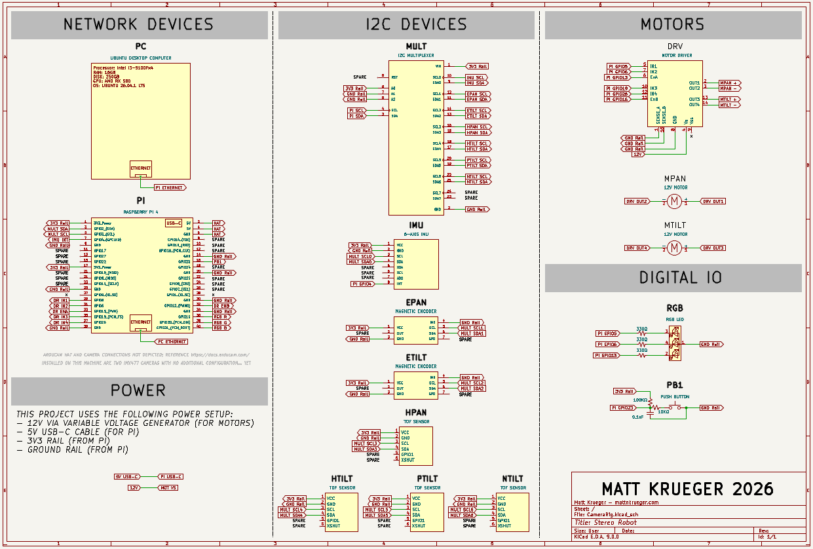
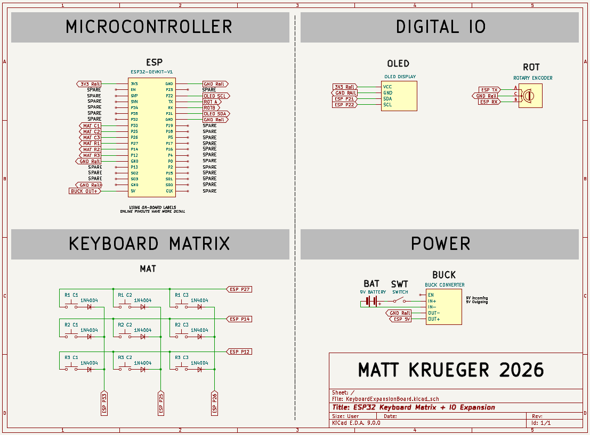
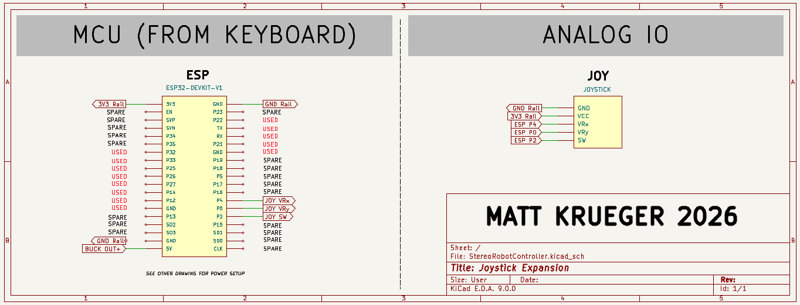
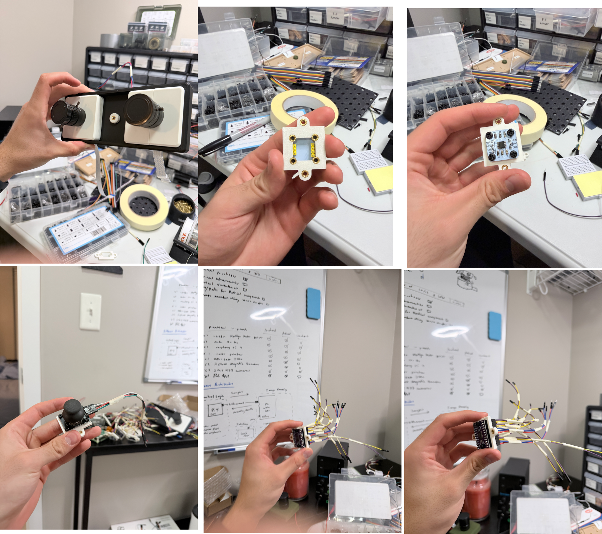
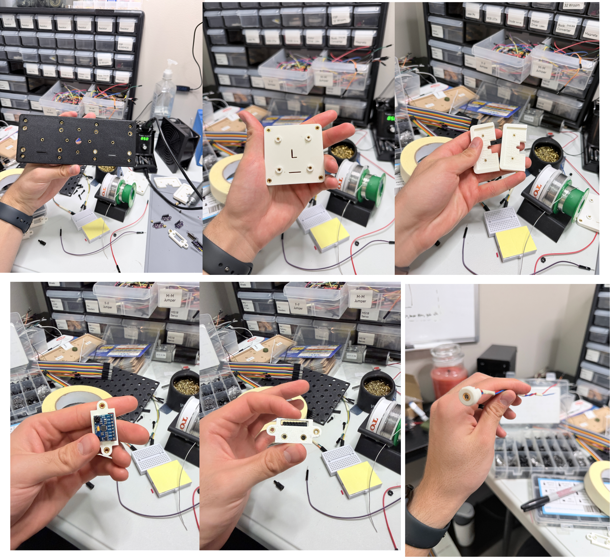
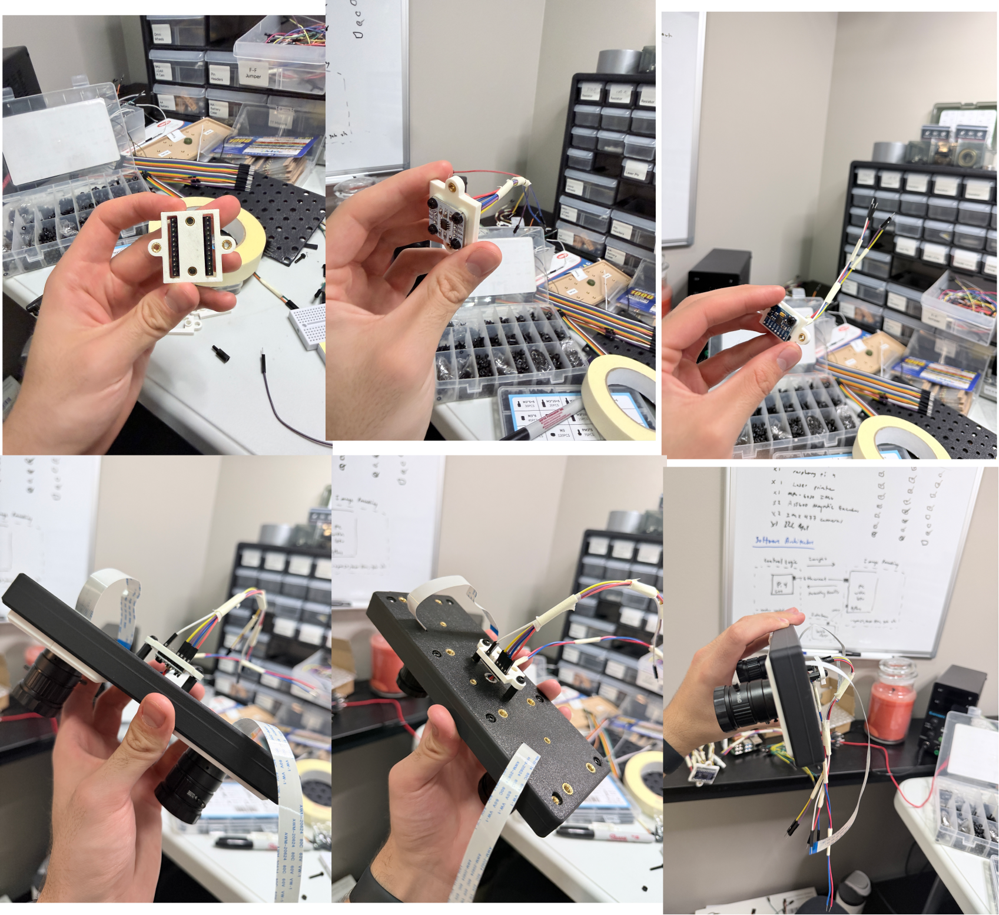

# Stereo Pan Tilt (Plus Laser) Machine

This project is currently under development!!! This project includes the development of a stereo pan/tilt camera machine, a keyboard/joystick controller, and a web interface.

## Approximate Progress
Project Categories:
- Electrical: 90% (creating PCB for Keyboard Matrix)
- Mechanical: 60% (planetary gearbox (pan) and tilt gear setup not completed)
- Assembly: 60% (all component mounts created, stereo plate assembled)
- Software: 5% (simple setup tests have been run to ensure that electrical parts are working)

Project Timeline:
- Project Start Date: 10/1/2026
- Project Target Completion Date: 1/1/2026

## Desired Features:
**Stereo Pan/Tilt Machine:**
- Stereo vision
- Motor control (x2)
- Motor encoding and homing
- Accurate laser pointer object targeting using computer vision
- State machine with inspiration from PackML

**Keyboard & IO Expansion Remote**
- 9x9 Keypad
- OLED Display
- up to 20 GPIO expansions to use for this project (Joystick module)
- Control the Stereo Pan/Tilt Machine 

**Web Interface:**
- Camera viewer
- System logging

## Electrical Designs
I split this into three electrical schematics for the Stereo Pan/Tilt Machine, the Keyboard & IO Expansion Remote, and the Joystick expansion. I have not looked to deeply into the industry standards for referencing pin connections. Coming from industrial automation schematics I opted to use reference tags for every wire (minus components in close proximity which references would be more confusing). Going for simplicity here...   

Stereo Pan Tilt

ESP Keyboard and Expansion

Joystick Expansion Module

## PCB
A PCB will be created to avoid wiring the 9x9 keyboard matrix and the esp32

## Assembly Photos
I have been assembling as I go as well as purchasing on the go. From my previous project (Ethical Restroom) I absolutely hated the screwing situation and spent a ton of time fooling around with different tolerances to try an get a tight screw fitting. This project I decided to use heat inserts (2.5m, 3m, 5m) for more rigidity. This will make the final build much stronger, however it is much more time consuming. Also, the plastic fumes from my 3D printer and soldering heat inserts may take some years off my life haha. 

## Bill of Materials and Cost
Not filling out this section until assembly has completed

# Thanks for reading! - Matt Krueger
